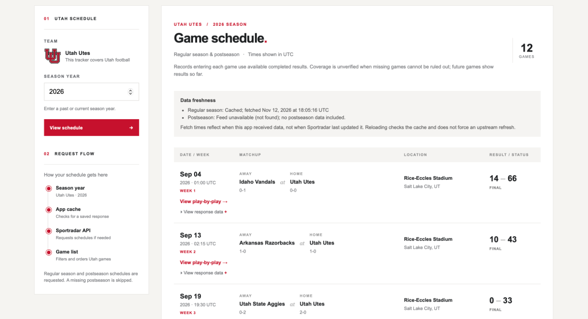
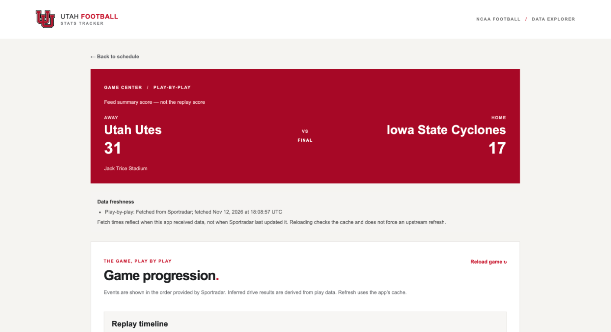
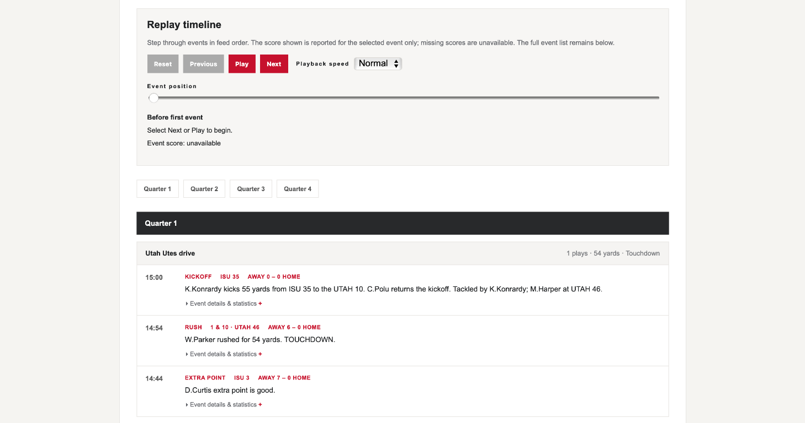

# Utah Football Stats Tracker

## Screenshots

**Season schedule** — browse Utah games, locations, results, and data freshness.



**Game center** — view the game summary and play-by-play freshness.



**Replay timeline** — step through events and explore drives by period.



## Quick start

With Ruby from `.ruby-version` and Bundler installed, run:

```sh
bundle install
DEMO_MODE=true bin/rails server
```

Visit `http://localhost:3000`. This uses bundled fictional data and needs no
Sportradar key. For live data, copy `.env.example` to `.env`, set
`SPORTRADAR_API_KEY`, and restart without `DEMO_MODE=true`; never commit `.env`.
See [Demo mode](#demo-mode) and [Quota protection](#quota-protection).

## What the app does

Enter a four-digit year to load a different season; games are ordered by scheduled time (UTC), with
games without a known time last. Expand a game to inspect its response data.
The location comes from the schedule feed, including the stadium name, city
and state when available; missing information is not inferred from the home team.
Matchup records show completed regular-season and postseason results before
each game, based on the available schedule feed. Future games show only
results available so far. A record is labeled "coverage unverified" when the
feed does not provide a usable played regular-season game number to check the
count. This label does not mean data is definitely missing. Where a record
cannot be determined it is marked unavailable; ties are included when present.
Select **View play-by-play** for a game to see its periods, drives, and events
in Sportradar's order. Expand an event for its underlying details and player
statistics. The reload link checks the cache; it does not force a new API request.
When a drive's result is missing, the game view labels results inferred from
its plays; if the feed does not provide enough evidence, the result is
displayed as unavailable.

The replay timeline steps through drive events and standalone events in feed
order. Use Previous, Next, Play/Pause, Reset, or the event-position slider;
playback speed controls the time between events, not game time. Select the link
to find the current event in the full list and inspect its statistics. The
replay displays only the score explicitly reported on the selected event,
marking missing values unavailable; the scoreboard above remains the feed's
game summary, not the replay score. Empty drives do not create replay events.
Replay requires JavaScript, but the complete event list remains available
without it. The demo replay is intentionally abbreviated.

## Architecture

Controllers use `DataSourceFactory` to select the live or demo source. The live client checks the cache,
then uses the request coordinator to enforce the persistent shared budget,
visitor limit and pacing before calling Sportradar. Both sources normalize
schedule data through `ScheduleGames`; `SeasonRecords` derives matchup records,
`DriveTeam` resolves possession and `DriveResult` conservatively interprets
drive outcomes. ERB partials render the schedule and game; game periods and
drives each have their own partial, and `app/javascript/replay.js` adds the
optional timeline.
Demo data comes only from `db/demo/`, not the live client.

Important directories: `app/services/sportradar/ncaafb/` contains the provider
and domain logic; `app/controllers/`, `app/helpers/`, and `app/views/` contain
the web interface; `test/` contains fixture, request, JavaScript and browser
tests. The generated importmap/Hotwire, Jbuilder and Solid gems and database
definitions remain installed Rails scaffolding; the current UI uses Propshaft
and plain JavaScript, and the production response cache is a file store. Do
not assume those generated components are configured application features.

## Configuration

| Variable | Purpose |
| --- | --- |
| `DEMO_MODE` | Set to `true` for bundled synthetic data. |
| `SPORTRADAR_API_KEY` | Live API credential; required outside demo mode. |
| `SPORTRADAR_ACCESS_LEVEL` | Provider access level; defaults to `trial`. |
| `SPORTRADAR_QUOTA_LIMIT` | Rolling upstream-attempt limit; required in live production. |
| `SPORTRADAR_QUOTA_WINDOW_SECONDS` | Global budget window; defaults to 86400 seconds. |
| `RAILS_MASTER_KEY` | Rails production credentials key. |
| `APP_HOST`, `RENDER_EXTERNAL_HOSTNAME` | Allowed public hostnames. |
| `FORCE_SSL` | Set to `true` only behind a trusted TLS-terminating proxy. |
| `PORT`, `RAILS_MAX_THREADS`, `RAILS_LOG_LEVEL` | Server port, thread count, and log level. |

## Tests and operational checks

Run `bin/ci` for setup, style/security checks, Rails and replay tests, and
browser tests. It requires Node.js and a Chrome-compatible browser/driver, and
security audits may need network access. `bin/setup` clears application logs
and temporary files. For focused checks, run `bin/rails test`,
`bin/rails test:system`, or `node --test test/javascript/replay_test.cjs`.
Tests use a single Rails worker because they currently modify process-global
configuration and some HTTP test doubles. Controller integration tests inject
their source factory through an internal request environment entry, not an
HTTP parameter or header; this keeps the replacement scoped to that request.

The app logs structured `sportradar.*` events for cache hits/misses, upstream
status and duration, limits, invalid responses, and coordination errors.
These events omit API keys, visitor identifiers, URLs and response bodies.
The `/up` endpoint checks Rails boot only and does not spend provider quota.
If state is reported invalid or missing, inspect the persistent storage and
provider usage before recovery; do not delete the state to bypass a limit.

## Data freshness and request behavior

The schedule combines regular-season and postseason feeds. A missing
postseason feed is skipped; other API errors are displayed. Responses are
cached in-app according to the existing Sportradar client cache policy.
Availability of historical seasons depends on your Sportradar subscription.
The schedule shows freshness separately for regular-season and postseason feeds;
the game page shows it for play-by-play. The displayed time is when this app
received the response, not the age of Sportradar's underlying data. Existing
cache entries created before freshness tracking are displayed with an unknown
fetch time until they expire. Missing postseason feeds are identified explicitly.
Closed game responses are cached for 30 days, current schedules for 10 minutes,
and older schedules for 30 days; upstream corrections may not appear until
the cached response expires.

Cache misses are coordinated between app processes sharing the same
`storage/sportradar_locks` directory and cache. Trial requests are spaced at
one per second. A 429 is retried once when its `Retry-After` delay is at most
two seconds (or after one second if the header is absent); longer delays and
repeated 429s are reported to the user. This does not coordinate separate
hosts or other clients using the same API key. Check your account's actual
QPS and rolling quota before deploying multiple instances.

## Demo mode

Start the app with `DEMO_MODE=true bin/rails server` (or set `DEMO_MODE=true`
in your development `.env`). Demo mode is an application-wide deployment
setting, not a per-user switch. Restart the server after changing it. It
requires no Sportradar key or quota configuration and does not use the live
client, its cache, or its request budget.

The bundled 2024 season contains one **fictional** Utah versus Sample State
game. Its score, records, stadium and abbreviated play-by-play are synthetic;
they are not historical results or a complete game. The banner remains visible
on the schedule, game, and error pages. Only 2024 and the sample game are
available; selecting another season or game reports that demo data is
unavailable, without falling back to Sportradar.

The JSON schedule, Utah games and play-by-play routes also use the sample and
include `X-Data-Source: demo`. The hierarchy, game summary and statistics
routes return 404 in demo mode because no representative samples are bundled.
Errors include the same source header. To use live data again, unset
`DEMO_MODE` or set it to `false` and configure the normal API credentials.
For a demo-only deployment, set `DEMO_MODE=true` in the platform's environment;
the provided Kamal template is for live mode, so remove its
`SPORTRADAR_API_KEY` secret entry if deploying without that key.

## Quota protection

Set `SPORTRADAR_QUOTA_LIMIT` to a positive integer to cap upstream attempts in
a rolling window, and optionally set `SPORTRADAR_QUOTA_WINDOW_SECONDS`
(default `86400`). Live production mode requires a limit; development and test are
unlimited unless one is configured. The supplied Kamal configuration starts
at 25 attempts per 24 hours, **not** a statement of your provider's quota.
Choose a lower budget if necessary for your plan, including other clients and
any monthly or other limits. This cap is local to this application and cannot
read or guarantee the provider's remaining quota.

Each network attempt reserves a slot before the request, including retries,
404s and failures; cached responses consume none. When exhausted, cached data
remains available and new requests receive the existing rate-limit message
(HTTP 429 on JSON endpoints). Slots expire on a rolling basis. The budget and
cooldown are persisted alongside the coordinator lock and shared between
processes on **one host using the same storage volume**. State is stored
separately from the stable lock file and atomically replaced.
Stop older application processes before deploying this state format: older
versions do not understand it and must not run concurrently with this version.
An older release cannot read the migrated state; do not roll back to it without
a coordinated state migration and accounting for provider usage.
Never delete or replace that state to obtain more requests. If its data becomes
corrupt, requests fail closed and the server logs a coordination error; inspect
the state and your provider's actual usage before recovery.
The first request migrates the existing lock-file state while holding the lock.
Allow for any usage by clients not coordinated by this application.
All concurrently running versions must use the same budget and window.

The global limit cannot coordinate other machines, installations, access levels
or clients sharing the key. In live mode, web requests also allow each client
IP up to 25 upstream attempts in a rolling two-minute window. Cache hits remain
available after that limit; retries and failed upstream attempts count. The
application stores a keyed digest of the IP, not the IP itself, in the
coordination state. Expired visitor entries are pruned on the next uncached
request, rather than by a background job. People behind the same NAT share a limit. This is not a
substitute for edge protection against distributed traffic. Ensure that proxy
and trusted-proxy settings make Rails' `remote_ip` trustworthy for your
deployment. Non-web uses of the client without a visitor key are not
per-visitor throttled, but still use the global budget.

Changing the key or access level creates a separate budget. When increasing the
window or enabling the limit for an existing app,
prior usage outside the recorded window is not known; account for it manually.
Keep the server clock synchronized. Deleting the storage volume loses both
cache and quota history.

## Deploy to Render

The included [Render Blueprint](./render.yaml) creates a **paid**, single-instance
Ruby web service with a 1 GB persistent disk. Confirm current [Render pricing](https://render.com/pricing)
before creating it. A disk is required for the existing file cache, quota
history, and SQLite files; Render's free web services cannot attach one.
Deploys with a disk have brief downtime and cannot scale to multiple instances.
This project uses SQLite on that disk for its current single-instance setup;
Render recommends Postgres for production Rails apps. A multi-instance or
high-availability deployment requires shared database, cache and distributed
quota coordination instead of this setup.

1. Commit and push your changes to the Git branch Render will deploy. Never
   commit `.env`, `config/master.key`, or API credentials.
2. In [Render](https://dashboard.render.com/), choose **New > Blueprint**,
   connect your Git provider and this repository, and select the branch
   containing `render.yaml`. Review the paid service and disk before creating
   them. Render uses the repository's `.ruby-version` (3.3.1).
3. During Blueprint setup, provide:
   - `RAILS_MASTER_KEY`: the contents of your local `config/master.key` file.
     Enter it in Render's secret field, not in the repository.
   - `SPORTRADAR_API_KEY`: your NCAAFB API key.
   - `SPORTRADAR_QUOTA_LIMIT`: a positive rolling-window request limit appropriate
     for your subscription and any other clients using the key. It is not
     automatically synchronized with Sportradar.
4. The Blueprint defaults to `trial` access and a `86400`-second quota window.
   Adjust `SPORTRADAR_ACCESS_LEVEL` and `SPORTRADAR_QUOTA_WINDOW_SECONDS` to
   match your account, preferably in `render.yaml` before creating the service.
   The rolling limit does not cover longer provider quotas or other clients.
5. Start the deployment and watch the Render logs. At startup the service runs
   `db:prepare` on the mounted disk, then binds to Render's `PORT`. The `/up`
   health check verifies Rails boot only. After deployment, open the generated
   `https://...onrender.com` URL and check the schedule and one game. Requests
   to an uncached feed consume API quota; missing or rate-limited feeds are
   reported in the app.

Render provides HTTPS and `RENDER_EXTERNAL_HOSTNAME`; the app automatically
allows that hostname. For a custom domain, configure it in Render and set
`APP_HOST` to the exact additional hostname. `FORCE_SSL=true` assumes traffic
arrives through Render's TLS-terminating proxy; don't expose the app directly.
Use an edge rate limiter or restrict access to prevent visitors exhausting your
API budget. Monitor Render logs, disk usage and Sportradar account usage.

The disk is mounted at `/opt/render/project/src/storage`, is unavailable during
builds and pre-deploy commands, and persists across deploys. Do not remove or
replace it without accounting for the lost quota history; restoring an older
snapshot also rolls that history back. If migrating an existing API key from
another installation, allow for earlier usage outside this new disk's history.
See [Render persistent disks](https://render.com/docs/disks) and
[Render web services](https://render.com/docs/web-services).

For a demo-only service, set `DEMO_MODE=true` in Render's environment and
redeploy. The Blueprint still prompts for the API key and limit on creation;
you may provide a placeholder key and any positive limit for demo mode. No
Sportradar requests are made in demo mode. Before switching it off, replace
those values with real credentials and an appropriate limit.

## Other production deployments

The included Dockerfile and Kamal configuration are a **single-host template**,
not a ready-to-run public deployment. Configure a real host, registry, DNS and
TLS proxy in `config/deploy.yml`; do not use the example IP or registry.
Configure a persistent volume at `/rails/storage`, writable by container UID
1000, and ensure the old and new containers share it during deploys.
Multi-host deployments require a shared, atomic cache and distributed
coordination before using this integration safely.

Provide `RAILS_MASTER_KEY` and `SPORTRADAR_API_KEY` through the deployment
platform's secret manager or environment; never put the key in the image or
commit it. For Kamal, export `SPORTRADAR_API_KEY` in the deployment shell and
provide `config/master.key` locally (or replace the corresponding lookup in
`.kamal/secrets` with your secret manager). `.env` is not shipped in the
image. Configure `SPORTRADAR_ACCESS_LEVEL`, the budget and window in
`config/deploy.yml` for your account. The template's quota settings must be
reviewed before deploying.

Terminate HTTPS at a trusted reverse proxy, set `APP_HOST` to the exact public
hostname for Rails host authorization, and set `FORCE_SSL=true` when the app
is reachable only through that TLS-terminating proxy. Do not expose the app
directly when using `FORCE_SSL`: it trusts the proxy for HTTPS. Configure the
proxy's own host filtering, request limits and monitoring. `/up` checks Rails
boot only; it does not check the API key, storage, or available quota. Monitor
application logs and provider usage, and verify a cached and uncached request
after deployment while accounting for quota.

For a local container smoke test after building the image, provide the secrets
as exported environment variables (not literal command-line values):

```sh
docker build -t ncaafb-stats-tracker .
docker run --rm -p 127.0.0.1:8080:80 \
  -v ncaafb_stats_tracker_storage:/rails/storage \
  -e RAILS_MASTER_KEY -e SPORTRADAR_API_KEY \
  -e SPORTRADAR_ACCESS_LEVEL=trial -e SPORTRADAR_QUOTA_LIMIT=25 \
  ncaafb-stats-tracker
```

Visit `http://localhost:8080/up` to check boot. This local-only example does
not configure TLS or host authorization. Stop the container when finished;
the named volume persists quota and cache state.
